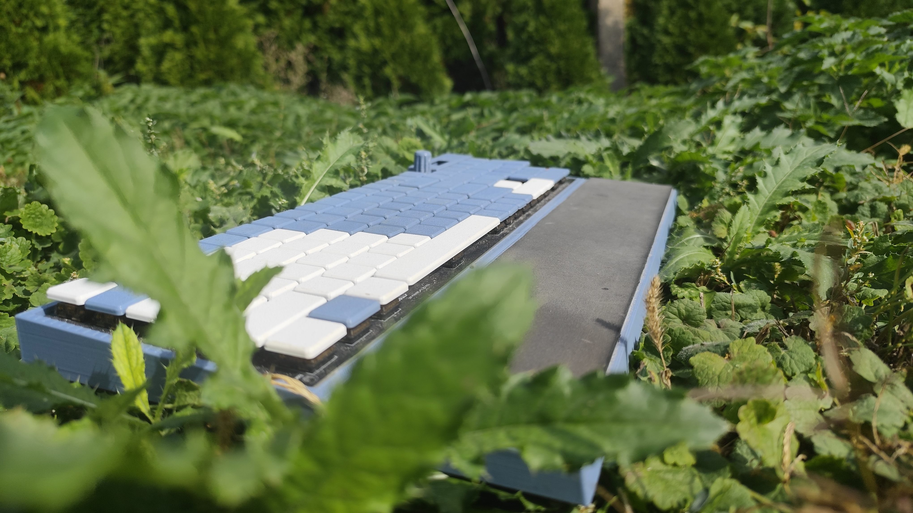

# Bubleboard

A custom full-size (104-key) mechanical keyboard with a hand-designed PCB, a rotary encoder, an e-ink display and [ZMK](https://zmk.dev) firmware. It was built as my graduation project (maturitní práce) at SPŠ a OA Uherský Brod, field Mechanik elektrotechnik, 2026.

## Features

- 104 keys in a 21 × 6 diode matrix (N-key rollover, no ghosting)
- Seeed XIAO BLE nRF52840 microcontroller soldered directly on the PCB
- Wired USB and Bluetooth Low Energy, with a LiPo battery connected through a JST connector
- Two MCP23017 I/O expanders (I²C) to drive the matrix
- Bourns PEC11L rotary encoder (15 mm) used as a media knob
- nice!view e-ink display (SPI) showing the keyboard status
- Hot-swappable Kailh Choc V1 sockets
- Custom 2-layer PCB designed in KiCad
- 3D-printed case and keycaps
- No backlight, to keep power consumption low

## Hardware

| Part | Component |
| --- | --- |
| Microcontroller | Seeed XIAO BLE nRF52840 |
| I/O expanders | 2× MCP23017 (SSOP), I²C with 10 kΩ pull-ups |
| Switch sockets | 104× Kailh Choc V1 hot-swap |
| Matrix diodes | 105× 1N4148W |
| Rotary encoder | Bourns PEC11L, push button wired into the matrix (Column 16 / Row 0) |
| Display | nice!view, connected over SPI |
| Decoupling | 2× 100 nF and 1× 10 µF |

The PCB was made by JLCPCB and assembled by hand. The schematic and PCB use the [marbastlib](https://github.com/ebastler/marbastlib) library, and the key positions come from a [Keyboard Layout Editor](http://www.keyboard-layout-editor.com) file imported into KiCad.

## Firmware

The firmware is built on ZMK (Zephyr). The matrix is defined in the keyboard's devicetree: columns 0–15 and 16–20 are spread over the two MCP23017 expanders, rows 0–5 are on the second expander, and all pins use `GPIO_ACTIVE_LOW` with pull-ups.

Encoder functions:

- Rotate right: volume up
- Rotate left: volume down
- Press: play / pause

### Building

Firmware is built with GitHub Actions using the standard ZMK user-config workflow. Push a commit (or run the workflow manually from the **Actions** tab) and download the firmware from the build artifacts.

The build uses:

- Board: `seeeduino_xiao_ble`
- Shield: `buble_board` plus `nice_view_adapter` and `nice_view`

The ZMK build needs `config/`, `boards/` and `zephyr/module.yml` to stay in the repository root.

## Case and keycaps

The case was modelled in Autodesk Fusion and 3D printed. It is printed in two halves that are glued together in the middle, with alignment holes and pegs. The PCB is mounted on six screw posts, and a separate display holder (adapted from a freely available model) slides into V-shaped tabs in the top right corner. The keycaps are also 3D printed, adapted from existing models.

## Measurements

Power consumption while connected to a PC (no backlight, no heavy load):

| Meter | V | A | W |
| --- | --- | --- | --- |
| Custom USB meter | 5.092 | 0.005 | 0.027 |
| Commercial USB meter | 5.1080 | 0.0050 | 0.0252 |

Input latency, measured with a 240 fps phone camera (1 frame ≈ 4.167 ms):

| Keyboard | Frames | Latency |
| --- | --- | --- |
| SteelSeries Apex Pro (magnetic) | 8 | 33.3 ms |
| Bubleboard | 11 | 45.8 ms |
| Razer Ornata Chroma (membrane) | 17 | 70.8 ms |
| School membrane keyboard | 19 | 79.2 ms |

## Author

Martin Janíček. Střední průmyslová škola a obchodní akademie Uherský Brod, 2026.